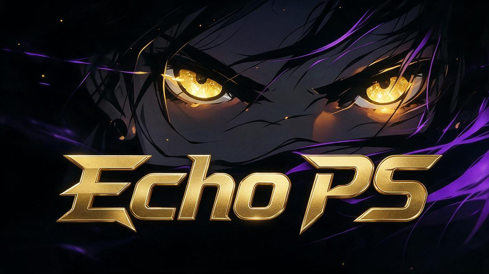

  

  

  <b>⛔ NOT PUBLIC YET — PRIVATE DEVELOPMENT BUILD ⛔</b>

  
  
  

<i>“Themes for the XMB. One package.”</i>

---

**Echo ThemeX** is a single `.pkg` for jailbroken PS3 consoles containing
pre-made **`.p3t` XMB themes**. Launch it once, and it writes the themes to
the **internal HDD** so the PS3's native Theme Settings can install them.

<b>✨ Features</b>

- 🎨 Bundled `.p3t` themes: Midnight Gold, Synthwave, Emerald
- 📦 One `.pkg` — no PC, no Bridge, no USB prep
- 💾 Writes themes to `/dev_hdd0/theme/`
- 🧭 On-screen guide for the PS3's native installer

<b>🧱 How it works</b>

| Step | Where |
|---|---|
| 1. Launch Echo ThemeX | PS3 XMB |
| 2. App writes `.p3t` files | `/dev_hdd0/theme/` |
| 3. Open PS3 Settings | Theme Settings → Theme → Install |
| 4. Pick a theme | Internal HDD |

<b>🛠️ Build</b>

---

**Proprietary. No forking, no redistribution.** See [LICENSE](LICENSE).
